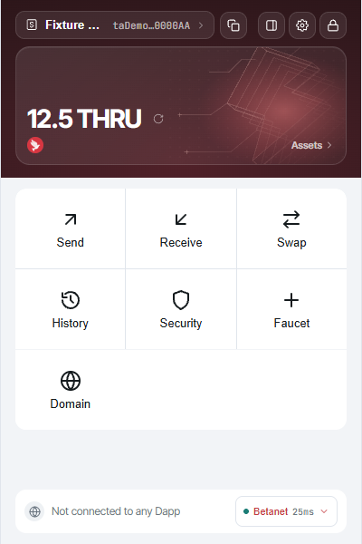
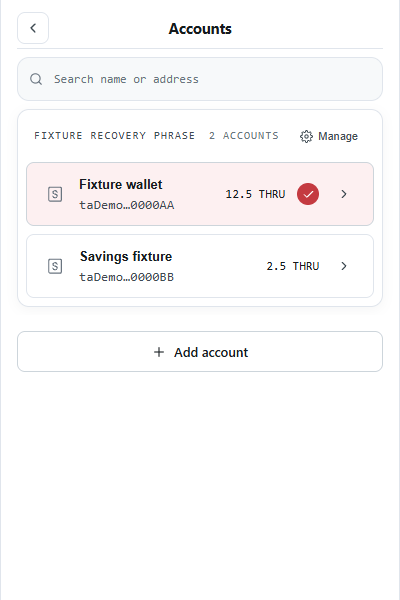
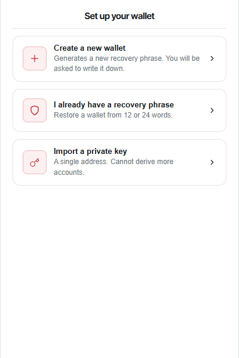
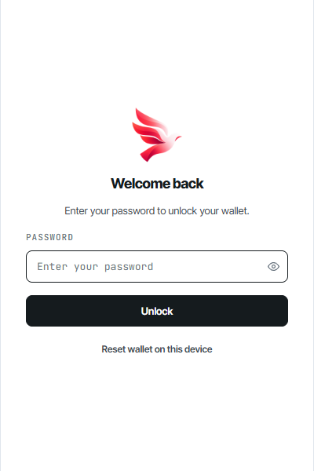
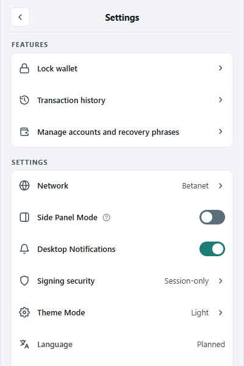
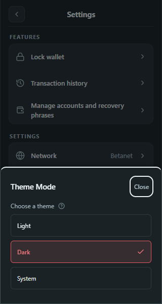
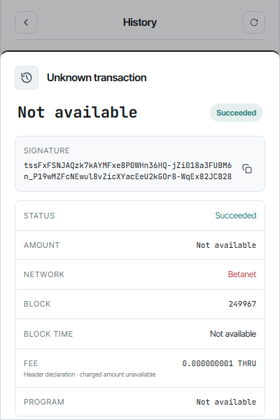
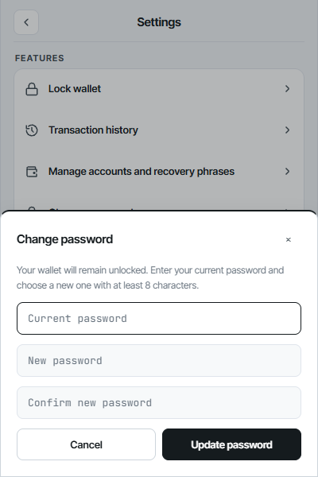

# UI Visual Record

This directory contains actual captures of the built frontend, not the synthetic Chrome Web Store
compositions in `store-assets/`. The operational owner is the
[visual record protocol](../MANUAL_SMOKE_CHECKLIST.md#visual-record-protocol).

- [Current gallery](current/gallery.md): selected safe states for every registered route, light/dark,
  popup, narrow and wide layout modes.
- [Current manifest](current/manifest.json): capture date, source revision and changes, browser,
  source/build/image SHA-256 hashes, scenario coverage, geometry and evidence limitations.
- [Capture commands](../../test/browser/README.md#visual-record-capture): reproduce the record or
  check freshness without browser tooling.

All current captures are **TESTED** with a mocked extension bridge and public fixture values.
Native MV3 hosting, real account balances, signing, live-network behavior and uncaptured interaction
states remain **UNVERIFIED** by this collection. Screenshots record appearance, not merge or design
approval. The manifest, not its directory name, determines which revision was captured.

## Recent Surfaces

### Dashboard

### Accounts

### Onboarding

### Unlock

### Settings

### Settings Picker

### History Detail

### Change Password

Earlier checked-in captures remain available in Git history. CI provides per-run PR/push artifacts
with a 30-day retention window; it does not write changes back into the repository. Refresh the
checked-in collection with each confirmed frontend change and after a merge that changes the build.
